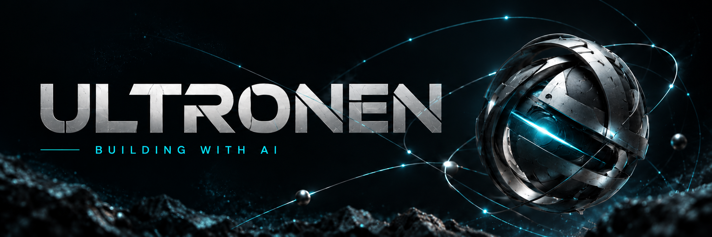

# Hi, I'm Ultroncn.

I build AI applications and developer tools. 
Currently building plugins for DeepSeek Harness and contributing fixes to agent and ML infrastructure.

---

### Projects I maintain

**[Session Archive](https://github.com/Ultroncn/dsh-archived-chats)** 
Search, organize, and back up conversations in DeepSeek Harness. Preview sessions, add tags and notes, and manage archives with ZIP import and export.

**[Liquid Glass](https://github.com/Ultroncn/dsh-liquid-glass)** 
A customizable glass-style appearance for DeepSeek Harness, with translucent surfaces, wallpapers, and opacity controls.

---

### Selected contributions

A few of my merged upstream contributions:

| Project | Contribution |
| --- | --- |
| **Google ADK-Go** | [Preserve buffered tool events when live streams end](https://github.com/google/adk-go/pull/1547); [remove external network dependency from the VertexAI RPC replay harness](https://github.com/google/adk-go/pull/1548). |
| **Burn** | [Preserve each caller's deterministic mode in async RL batches](https://github.com/tracel-ai/burn/pull/5574); [fix overflow in boolean indexed updates](https://github.com/tracel-ai/burn/pull/5629). |
| **DSH Market** | [Filter plugins by the current host version](https://github.com/dsh-market/dsh-market/pull/486); [add service-specific GitHub route fallbacks](https://github.com/dsh-market/dsh-market/pull/482). |
| **Sympozium** | [Keep the default PostgreSQL MCP server suspended until configured](https://github.com/sympozium-ai/sympozium/pull/420). |
| **Dify** | [Make the dataset segment-count query use an explicitly supplied database session](https://github.com/langgenius/dify/pull/42523). |

[More merged contributions](https://github.com/pulls?q=is%3Apr+author%3AUltroncn+is%3Amerged+-user%3AUltroncn)

---

`$ build something useful_`
